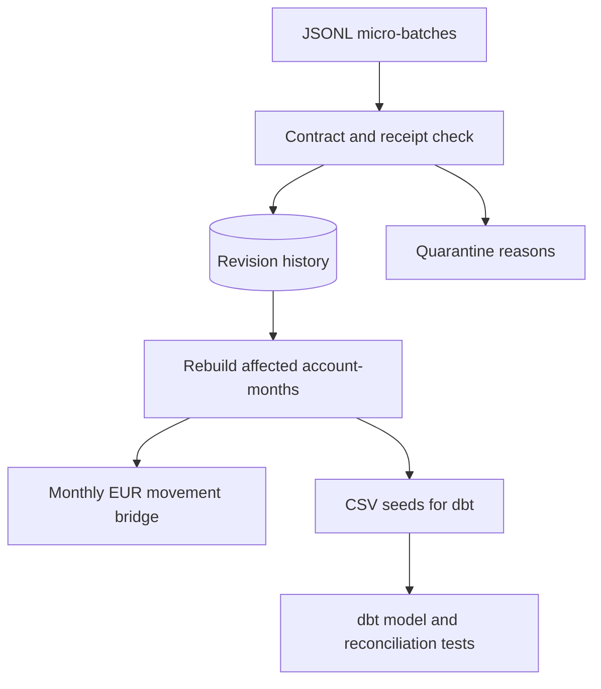

# Incremental subscription revenue ledger

**Can finance reproduce last month’s recurring revenue?** A billing feed can deliver a cancellation before its original contract or revise a backdated amount. Finance needs a monthly recurring revenue bridge where every movement reconciles and an engineer can replay corrections safely.

The demo processed 254 distinct revisions for 120 synthetic accounts, quarantined one malformed row and produced 1,440 account-month balances. Reversing the order of all three batches produced identical monthly bridges. December closed at €8,433 recurring revenue in this fixture.

## Try it locally

Use Python 3.12 from the repository root. The demo generates its own synthetic inputs in a temporary directory and prints a decision readout.

```powershell
py -3.12 -m venv .venv
.\.venv\Scripts\python.exe -m pip install ".[dev]"
.\.venv\Scripts\python.exe scripts/demo.py
.\.venv\Scripts\python.exe -m unittest discover -s tests -v
```

On Linux or macOS, use `python3.12 -m venv .venv` and `.venv/bin/python` for the remaining commands. For the persistent example below, activate the environment first with `.\.venv\Scripts\Activate.ps1` in PowerShell or `source .venv/bin/activate` in Bash.

## Persistent example

```shell
revenue-ledger generate inputs
revenue-ledger --db ledger.sqlite load inputs
revenue-ledger --db ledger.sqlite report
revenue-ledger --db ledger.sqlite export dbt/seeds
```

`generate` expects an empty directory. On subsequent runs, start at `load`. Input is one JSON object per line, for example:

```json
{"account":"acct_0001","effective":"2026-02-01","version":1,"cents":3900,"currency":"EUR"}
```

To exercise the optional DuckDB adapter in a separate Python 3.12 virtual environment:

```shell
python -m pip install dbt-duckdb==1.9.2
dbt build --project-dir dbt --profiles-dir dbt
```

The repository includes the synthetic seeds so the dbt build can run independently. Every monthly closing balance must reconcile to the specifically classified movements. [All twelve monthly closes](docs/bridge.json)

## Architecture and methodology



Grain is one EUR account balance per calendar month end. For each effective date use the highest revision and carry the most recent balance forward. A zero balance ends recurring revenue. The bridge reconciles opening + starts + expansion − contraction − churn to closing. Starts include reactivations. Calendar year 2026 is fixed in the sample. The opening balance before January is assumed zero.

Python’s standard library and SQLite handle contracts, transactions and an inspectable warehouse. A second SQL implementation in dbt reads exported seeds for parity checks. The dbt SQL and assertions were exercised in SQLite after resolving relation names. The DuckDB adapter build is configured for CI and awaits execution.

## Verification and operations

4 automated tests passed locally. The standalone demo ran twice with matching decision outputs. The batch smoke test exercised the full pipeline and replay. The repository includes a GitHub Actions workflow and Docker configuration. Hosted CI and container execution are pending.

Supply a closed UTF-8 JSONL file with a fresh batch name. Run the load command periodically to process new files. Same-name, same-byte batches are safe to retry. Reused names with different bytes and conflicting revisions abort the whole batch. Inspect `rejects` by name and line. Correct rejected records under a new receipt identity. For reconstruction, load all original batches into an empty database and compare the bridge. A proposed acceptance objective is zero unreconciled cents at close.

## Limitations and next release

The fixed calendar and one balance per account exclude multi-currency conversion, per-subscription proration and booked opening balances. A serial writer and a twelve-month rebuild per touched account have predictable local costs. A high-volume ledger would need partitioned writes, retention and a versioned calendar.

Begin with the contract and calendar. Add batch receipts and atomic account rebuilds. Then validate local SQL parity and review definition ownership with finance. Next run the DuckDB adapter in CI and test opening balances spanning two years.

[Product requirements, architecture decision and runbook](docs/design.md) · [Example output](docs/example.json) · [Executed commands and results](docs/verification.txt) · [Interview walkthrough](docs/interview.md)
